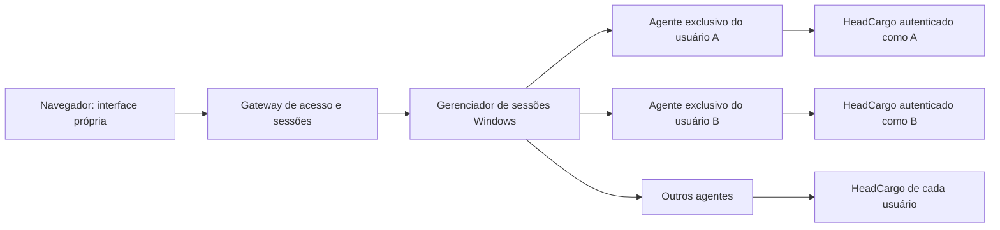

# Ponte web do HeadCargo — análise inicial

Data: 18/11/2026. Este documento é uma proposta de arquitetura, não uma implantação ou uma confirmação de compatibilidade de todas as telas.

A primeira etapa de código foi iniciada após esta análise. Consulte [implantação local e limites atuais](ponte-web-implantacao.md) para separar o que já está implementado do que ainda depende da validação no HeadCargo.

## Requisitos confirmados

- Interface web própria, funcionando como ponte das telas do HeadCargo.
- Mais de cinco pessoas usando simultaneamente.
- Os mesmos nomes de usuário e senhas do HeadCargo.
- Nenhum comando SQL de escrita enviado pela ponte ao banco do HeadCargo.
- Consultas e operações executadas pelo aplicativo instalado, conservando suas validações e permissões.

Ao salvar pela tela, o próprio HeadCargo poderá gravar no banco. A restrição é não escrever diretamente no banco pela nossa aplicação. O primeiro protótipo deve operar somente pelas telas; leituras SQL não são requisito desse desenho.

## Resultado da inspeção do Maicon

| Componente | Base disponível | Adaptação necessária |
| --- | --- | --- |
| Interface React | Tabelas, estados de andamento e integração com o bot | Portal de telas separado do chat |
| Autenticação | Identidade Google e sessões próprias do Maicon | Fluxo novo para autenticar no aplicativo HeadCargo |
| Execução desktop | PowerShell, UI Automation, OCR e Win32 | Agente por sessão Windows, desacoplado da API web |
| Concorrência | Fila e trava do desktop em `server/filaDesktop.js` | Roteamento por usuário e sessão; uma fila por agente |
| Operações persistentes | Tarefas, etapas e retomada após interrupção | Vincular tarefas à sessão autenticada do HeadCargo |
| Navegação | Abertura de processo/atividade e busca de abas | Validar em sessão real; há controles ainda sem compatibilidade comprovada |
| SQL | Proteção de leitura em `server/seguranca.js` | A ponte de telas não precisa receber credenciais SQL |

Os caminhos desktop atuais são restritos ao administrador e mantêm alterações em processos de teste. A análise não remove essas restrições.

## Arquitetura recomendada

O HeadCargo continua instalado em Windows. A interface web é uma camada de apresentação e comando. Para cada ação, o agente valida usuário, processo, atividade e tela atual, executa um comando permitido e devolve o resultado observado. As sessões de usuários diferentes não compartilham mouse, teclado, janela, imagens ou tarefas.

Uma única tela com uma fila global não atende uso interativo simultâneo: apenas colocaria todas as pessoas esperando e poderia misturar o contexto exibido.

### Infraestrutura a comparar na prova de conceito

1. Windows Server com sessões RDS isoladas e um agente dentro de cada sessão de usuário.
2. Máquinas virtuais Windows dedicadas por sessão ativa.

A escolha depende da compatibilidade do HeadCargo com o ambiente, permissões, licenciamento aplicável, memória e comportamento ao desconectar. Não foi dimensionada nem instalada infraestrutura nesta etapa.

## Login com a mesma credencial do HeadCargo

1. A pessoa informa usuário e senha no portal por HTTPS.
2. O gateway reserva um agente isolado ainda sem acesso a dados de outro usuário.
3. O agente realiza o login na tela nativa do HeadCargo.
4. O portal libera a sessão somente depois de verificar sucesso e identidade no aplicativo.
5. A sessão web fica vinculada ao usuário, ao agente e à sessão Windows correspondente.
6. A senha não é persistida por padrão. Não entra em logs, tarefas, histórico do chat, capturas ou armazenamento do navegador.

Não validar senha comparando dados de tabelas do ERP, não aceitar qualquer senha para simular o acesso e não operar todas as contas com um login administrativo compartilhado. A existência de uma API oficial adequada de autenticação e operações ainda precisa ser confirmada com a Headsoft; integrações anunciadas com terceiros não demonstram esse contrato.

É preciso observar na prática: controles do login, mensagens de erro, identificação do usuário conectado, expiração, autenticação adicional e comportamento com sessões simultâneas da mesma conta. Se não houver verificação confiável da identidade na tela, esse modo de login não deve ser anunciado como concluído.

## Como construir telas próprias

Cada tela precisa de um adaptador específico. Não basta copiar a imagem do aplicativo para obter campos HTML confiáveis.

- **Leitura:** UI Automation para controles disponíveis; OCR para campos sem acesso estruturado.
- **Comando:** ações semânticas, como abrir processo, selecionar atividade e consultar requisitos. O cliente não escolhe um agente arbitrário nem envia PowerShell, SQL ou coordenadas livres.
- **Validação:** confirmar o processo e a aba antes de interagir; diferenciar campo vazio de campo não identificado.
- **Conclusão:** separar comando recebido, comando executado e resultado confirmado. Em caso de efeito incerto, não repetir automaticamente uma operação.
- **Estado da tela:** descartar comandos de uma versão antiga da tela e serializar operações dentro da mesma sessão.
- **Permissões:** conferir acesso no gateway e deixar o próprio HeadCargo aplicar suas permissões, inclusive recusas.

Um visualizador remoto opcional pode apresentar a tela original em casos ainda não adaptados ou que exigem intervenção humana. Apache Guacamole é uma alternativa para acesso remoto pelo navegador, mas não converte controles nativos em uma interface própria.

## Primeiro fluxo a validar

| Etapa | Entrega | Critério de aceite |
| --- | --- | --- |
| 1 | Inventário do login e das telas de processos/atividades | Identificar controles, estados e evidências sem alterar dados |
| 2 | Uma sessão isolada com login nativo | Aceitar credenciais válidas, recusar inválidas e conferir a identidade |
| 3 | Consulta de um processo e suas atividades na web | Dados correspondem à tela nativa; outro processo não é acionado |
| 4 | Navegação de ida e volta | Abrir processo e aba sem depender de cliques prévios do operador |
| 5 | Uma operação em processo de teste | HeadCargo aplica validações; interface relata o resultado sem repetir ações |
| 6 | Concorrência inicial de seis usuários | Nenhuma mistura de usuários, dados ou comandos; medir espera e consumo |
| 7 | Interrupção e retomada | Tratar janela fechada, sessão bloqueada, perda de conexão e resultado incerto |

Essa sequência valida o mecanismo antes de ampliar para financeiro, documentos, propostas e demais módulos. Se as telas não expuserem controles suficientes, o resultado da prova de conceito pode recomendar acesso remoto às telas originais para determinados fluxos.

## Pendências reais

- Disponibilidade do HeadCargo para inspeção e teste na sessão Windows de destino.
- Verificação da autenticação nativa e do usuário efetivamente conectado.
- Definição do pico esperado além dos seis usuários iniciais do teste.
- Compatibilidade e condições para sessões simultâneas do aplicativo.
- Inventário das telas desejadas e dos controles que podem ser lidos com confiança.
- Medição de recursos por sessão e tempos das operações; ainda não há estimativa confiável de capacidade, custo ou prazo global.

## Referências consultadas

- Apache Guacamole: [arquitetura do gateway web e guacd](https://guacamole.apache.org/doc/gug/guacamole-architecture.html).
- Microsoft: [execução de automações desktop em sessões não assistidas](https://learn.microsoft.com/en-us/power-automate/desktop-flows/run-unattended-desktop-flows).
- Microsoft: [limitações de integridade e segurança no UI Automation](https://learn.microsoft.com/en-us/windows/win32/winauto/uiauto-securityoverview).

Essas referências descrevem mecanismos e limitações das plataformas. Não constituem validação do HeadCargo nesse ambiente nem decisão de adotar Power Automate.
